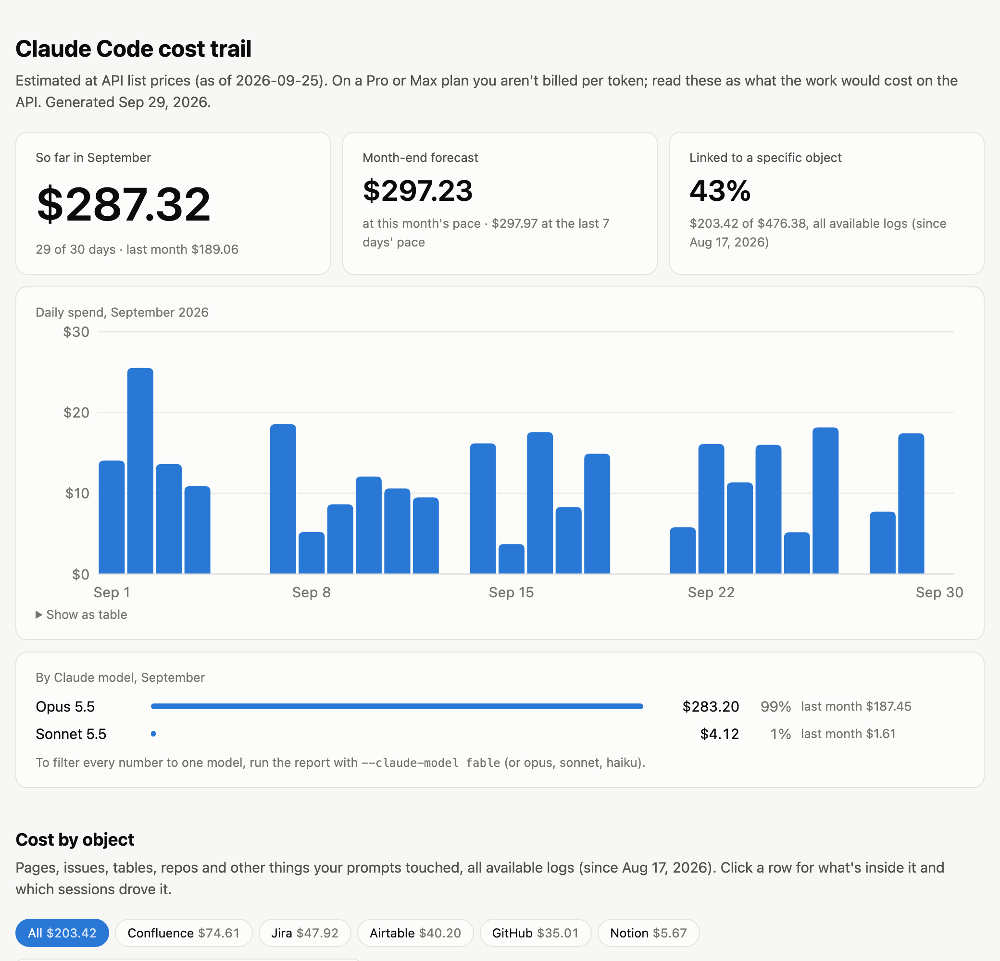
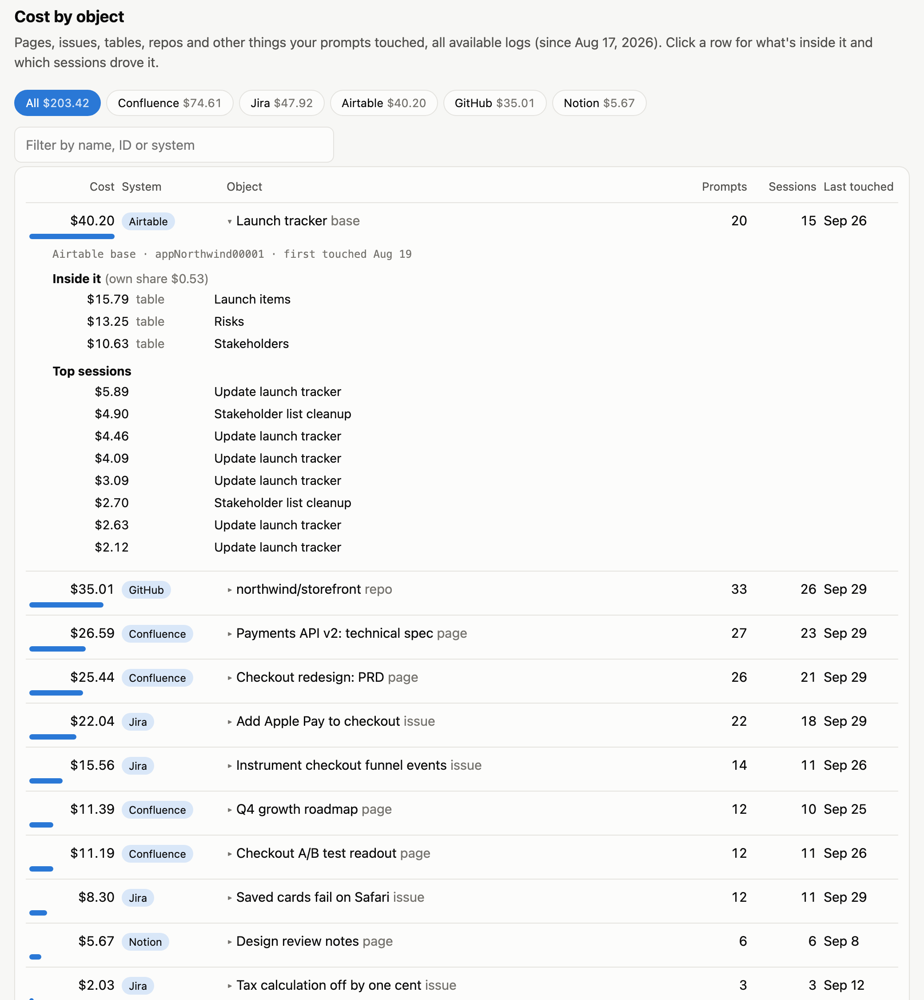

# claude-cost-trail

**What did that spec cost?** `claude-cost-trail` reads Claude Code's local session logs and traces spend to the *things* the work touched: a Confluence page, a Jira ticket, an Airtable table, a GitHub repo or PR. It follows each one across every session that touched it.



Most cost tools answer *when* you spent (per day, per session) or *through what* (per model, per MCP server). This one answers *on what*:

> The payments API spec cost $26.59 across 23 sessions over six weeks. Just under 60% came from reviewing it; the rest came from the Apple Pay work that kept going back to it.

That question has an ID behind it. When Claude reads or edits a Confluence page, the page ID is sitting in the tool call. The same ID shows up in next week's session, and in the one after that. Link those calls to the tokens spent around them and you get a cost per object.

## Quick start

**As a Claude Code plugin**, so you can just ask Claude:

```
/plugin marketplace add cameroniharris/claude-cost-trail
/plugin install claude-cost-trail@claude-cost-trail
```

Then ask: *"What did the checkout PRD cost?"*, *"How much have I spent this month?"*, or *"Which Jira tickets were most expensive?"*

**Or from the command line.** It needs Python 3.9+ and nothing else:

```bash
git clone https://github.com/cameroniharris/claude-cost-trail && cd claude-cost-trail
./bin/cost-trail                       # spend, forecast, top objects
./bin/cost-trail show "payments api"   # one object: children, sessions, dates
./bin/cost-trail compare               # the same spend under four attribution models
./bin/cost-trail report --open         # the HTML report above
```

To try it without your own logs: `python3 examples/make_sample_logs.py /tmp/demo && ./bin/cost-trail --projects /tmp/demo`.

| Command | What it answers |
|---|---|
| `summary` (default) | Spend so far this month, month-end forecast, top objects, and where the unattributed spend went |
| `spend` | Month-to-date, the forecast at two paces (this month's, and the last 7 days'), and spend by Claude model |
| `objects` | Cost per object, largest first. `--system Jira` narrows it. |
| `projects` | Cost per working folder or repo, how much of it touched an object, and its top objects |
| `compare` | Every object's cost under four attribution models, side by side |
| `show <name or ID>` | One object's total, what's inside it, and which sessions drove it |
| `report` | A self-contained HTML page. `report.html#checkout` opens straight to a matching object. |

Every command takes `--days 7`, `--month 2026-09`, `--since/--until`, `--json`, `--model` (`linear`, `first`, `last` or `carry`; linear is the default), and `--claude-model` to count only one Claude model's responses (`fable`, `opus 5.5`, `sonnet`…). With that filter, every number (objects, folders, forecast) covers just that model's work, including the objects its tool calls touched.



## How cost is attributed

This is an attribution problem, the same one marketing analytics has had for years: one conversion, several touchpoints, and a question of who gets the credit. The design choices below borrow from there.

**The unit is a prompt:** one message you typed plus everything Claude did in response, including any subagents it launched. Claude Code stamps each prompt with an ID, and subagent logs carry the ID of the prompt that launched them, so the grouping is read straight from the logs.

**Each prompt's cost is split evenly across the distinct objects it touched.** In attribution terms, this is a *linear* model at the prompt level. A prompt that touched nothing counts as **unattributed**. Nothing is carried forward to later prompts.

A worked example, with one session costing $6.00:

| Prompt | Touched | Cost | Linear (this tool) | Carry-forward | Full credit |
|---|---|---|---|---|---|
| 1 | Airtable base A | $1.50 | A $1.50 | A $1.50 | A $6, B $6, P $6 |
| 2 | base B + Confluence page P | $3.00 | B $1.50, P $1.50 | B $1.50, P $1.50 | |
| 3 | nothing (editing code) | $1.50 | unattributed $1.50 | B $0.75, P $0.75 | |
| **Total** | | **$6.00** | **$6.00 ✓** | **$6.00 ✓** | **$18.00 ✗** |

- **Full credit** answers "how much work involved P?" but the totals add up to three times what you spent, so they can't be summed or reconciled. The tool reports that idea as a separate *sessions touched* count instead.
- **Carry-forward** (unlinked work belongs to whatever was touched last) is tempting, because work after reading a spec is often about the spec. But it quietly credits unrelated follow-up work. Claude Code's own `/usage` attribution worked this way until v2.1.222, when it switched to counting only requests that actually used the MCP server's results, because carry-forward overstated each server's share.
- **Linear per prompt** reconciles to the dollar and is easy to defend. Its known weakness: a prompt that glances at one page while doing heavy work on another gives both pages the same share.

### Compare the models yourself

The choice of model changes the answer, so the tool shows all four side by side (`compare`, and a section of the
report). From the sample data:

| Object | Linear | First touch | Last touch | Carry-forward |
|---|---|---|---|---|
| Launch tracker (Airtable) | $40.20 | $40.20 | $40.20 | $66.11 |
| northwind/storefront (GitHub) | $35.01 | $10.20 | $62.50 | $47.34 |
| Payments API v2: technical spec | $26.59 | $26.69 | $7.73 | $32.42 |
| Unattributed | $272.96 | $272.96 | $272.96 | $183.03 |

First and last touch disagree most about the repo, because a PR is usually the *last* thing a prompt touches.
Carry-forward cuts "unattributed" by a third by crediting follow-up prompts ("now update the tests") to whatever
came before. That's plausible for the tracker, but it's a guess the data can't back up.

**Parents include their children.** A base's total includes its tables, and a repo's includes its issues and PRs. Within a single tool call, only the most specific object counts (the table, not also its base), so a call never splits its cost between a parent and its own child.

**The invariant:** object totals plus unattributed equal total spend, and the tests check that.

## What counts as an object

Objects come from **tool inputs**: IDs in MCP calls, and links anywhere in a tool call (a URL passed to WebFetch, a browser, or `gh` in Bash counts too). Names come from what those tools returned: a `getConfluencePage` result carries the title, and a `list_bases` result names every base.

| System | Recognized from |
|---|---|
| Confluence | page IDs in Atlassian MCP calls; `…atlassian.net/wiki/…/pages/<id>` links |
| Jira | issue keys in Atlassian MCP calls; `…atlassian.net/browse/ABC-123` links |
| Airtable | base and table IDs (`app…`, `tbl…`) in Airtable MCP calls; `airtable.com/app…/tbl…` links |
| GitHub | owner/repo (+ issue/PR number) in GitHub MCP calls; `github.com/…` links; `gh … --repo owner/repo` |
| Notion | page IDs in Notion MCP calls; `notion.so/…<id>` links |
| Linear | issue keys in Linear MCP calls; `linear.app/…/issue/ABC-123` links |
| Any other MCP server | ID-looking inputs (`documentId`, `threadId`, `slug`…), labeled with the server's name |

**Connectors with random names.** Connectors added through claude.ai show up in the logs under a random ID (`1a2b3c4d-…`) instead of a name. The tool labels them from the tools they expose: a server with `list_bases` is Airtable. To name the rest, add a config file at `~/.config/claude-cost-trail/config.json`:

```json
{ "server_names": { "0f3c2a9e-1b7d-4c55-9e21-7a6b5d4c3e2f": "Monologue" } }
```

To teach it a new system, see [docs/rules.md](docs/rules.md). Rules are JSON, not code.

## Cost by project folder

Most spend in a coding-heavy workflow touches no object: it's reading and editing files. `projects` (and a section
of the report) shows all spend by working folder, with git worktrees folded into their repo. For each folder it
shows how much touched a specific object and which objects those were. That answers "what did this repo cost?" and
tells you how much of the object view to trust for that folder.

## What I found in my own logs

I ran it on about three months of my own Claude Code use, roughly $7,000 at API list prices:

- **Only 14% of spend touched a specific object.** Most of the rest was app development, which reads and edits files
  rather than objects. One app's folder alone came to about $2,800, with only 4% of it touching an object. The folder
  view is what makes that visible.
- **The most expensive object was a personal tracking base in Airtable, at about $790.** Two of its tables accounted
  for 70% of that. The drill-down pointed to a habit, not a project: a handful of small skills that write reviews
  into those tables. Each run was cheap, but together they cost more than some whole projects.
- **The attribution model matters.** Under carry-forward, the same base would have been credited about $1,340, 70%
  more, almost all of it from follow-up prompts that never touched Airtable. That's why linear is the default.
- **The per-model view found money.** More than half of one month's spend ran on an older model that costs more per
  token than its successor. It was a default I'd never revisited.
- **A per-server view would have hidden all of this.** "Airtable: 11% of usage" doesn't say which table, or which
  habit, is driving it.

## Accuracy and limits

- **These are estimates at API list prices** (`cost_trail/pricing.json`, dated). On a Pro or Max plan you aren't billed per token, so the number means "what this would cost on the API". Prices cover input, output, 5-minute and 1-hour cache writes, cache reads, fast mode, and web search.
- **History only goes back as far as Claude Code keeps logs**: `cleanupPeriodDays` in settings, 30 days by default. Raise it if you want longer trails.
- **Objects only come from tool calls.** Work on a spec pasted into the chat, or a file read from disk, can't be linked to the Confluence page it came from.
- **The object has to be in the logs.** Each response is counted once, even when a resumed session copies earlier history into a new file.
- **Tested against Claude Code 2.1.x logs.** The log format isn't a public API; if it changes, the parser (`cost_trail/parse.py`) is where to look.

## Prior art

[ccusage](https://github.com/ccusage/ccusage) is the reference for spend totals (per day, month and session). Claude Code's own `/usage` screen attributes usage to skills, subagents and MCP servers. [agent-cost-mcp](https://github.com/vk0dev/agent-cost-mcp) and [claude-cost-attribution](https://github.com/bengodgart/claude-cost-attribution) go down to tools, subagents and skills. [tuneloop](https://github.com/tuneloop/tuneloop) links cost to merged PRs. As of September 2026 I couldn't find anything that follows an individual *object* across sessions, which is the gap this fills. The longer survey is in [docs/prior-art.md](docs/prior-art.md).

## Privacy

It's read-only and runs offline. It never writes to `~/.claude`, never calls the network, and the HTML report has no external assets. The screenshots and tests use a synthetic dataset (`examples/make_sample_logs.py`).

## Development

```bash
python3 -m unittest discover tests
```

Standard library only. The code layout, for anyone extending it: `parse.py` reads logs into prompts, `pricing.py` prices usage, `rules.py` + `rules.json` recognize objects, `attribute.py` splits cost (all four models) and groups it by folder, and `cli.py` / `report_html.py` present it.

Built by [Cameron Harris](https://github.com/cameroniharris), a digital analyst, with Claude Code. MIT licensed.
